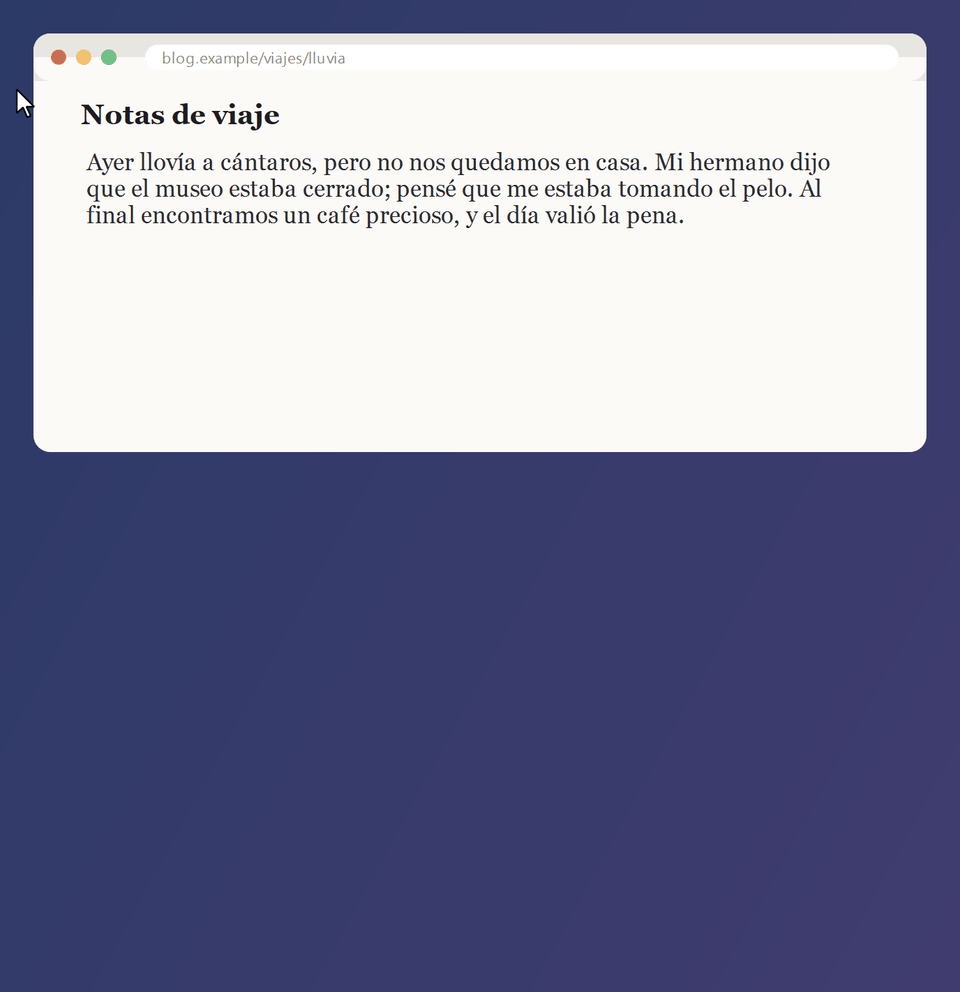
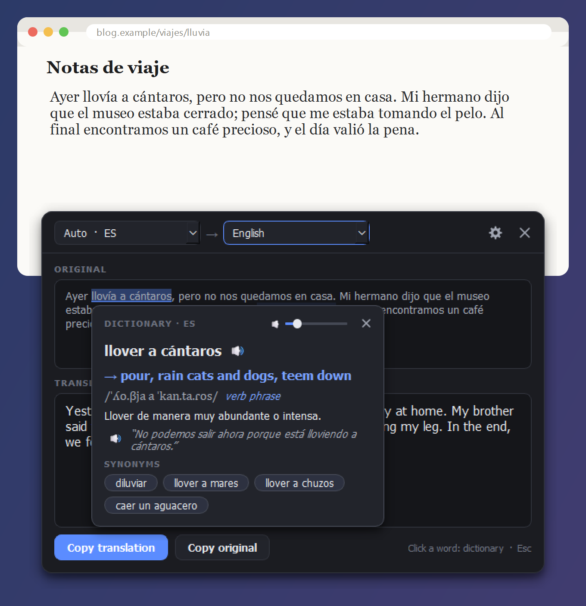
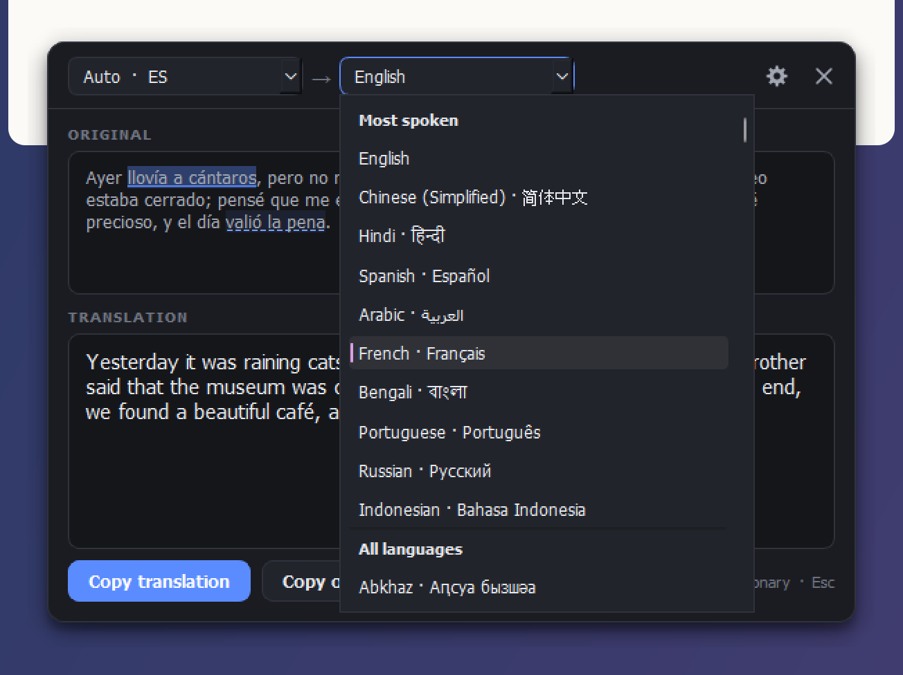
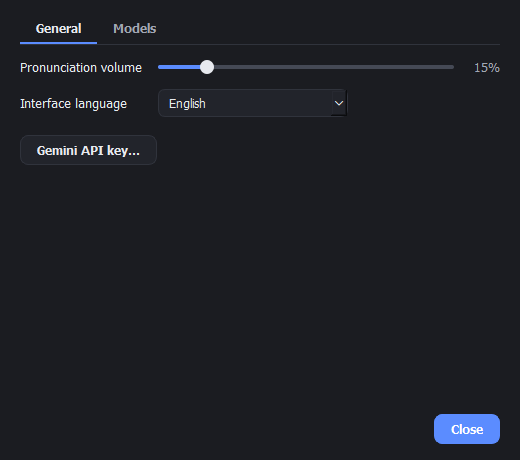
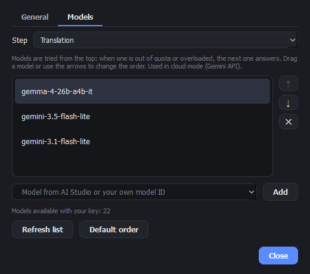
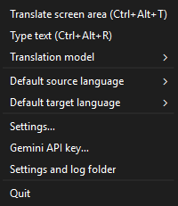

# AiScreenTranslator

**English** | [Русский](README.ru.md)

Translate any text on your screen with one hotkey. Select an area, and a small window shows the
text and its translation right next to it. Click any word for a dictionary card with
pronunciation, meaning, example, synonyms and audio. Idioms are found and explained as a whole.

Works on Windows 10/11. Text is read and translated by the Google Gemini API with your own free
key. It can also run fully offline with Tesseract OCR and a local model in LM Studio.



## Download

Get **ScreenTranslator.zip** from the
[latest release](https://github.com/DemonCoder354/AiScreenTranslator/releases/latest), unzip it
anywhere and run `ScreenTranslator.exe`. Nothing else needs to be installed: Tesseract and all
libraries are inside.

On first start the app asks for a free Gemini API key: open
[aistudio.google.com/apikey](https://aistudio.google.com/apikey), sign in with a Google account,
click **Create API key** and paste it into the app. The key is stored only on your computer
(in the `GEMINI_API_KEY` user environment variable).

> The exe is not signed with a code-signing certificate. Windows SmartScreen may show
> "Windows protected your PC": click **More info** -> **Run anyway**. If Smart App Control is
> turned on, Windows blocks unsigned programs completely; then run the app from source
> (see below).

## Features

- **Ctrl+Alt+T**: select an area of the screen, get the translation in a window next to it.
- **Ctrl+Alt+R**: a window to type or paste text.
- **233 languages** in both directions: the national languages of every country and other
  languages with more than about 100,000 speakers. The 10 most spoken languages are listed first.
- **Language detection by the model**: the window shows the source language it found.
- **Dictionary card**: click any word for its lemma, 2-4 translations, IPA, part of speech,
  meaning in context, example and synonyms, all in the word's own language, with audio
  (Gemini Live voice, or Windows voices offline).
- **Idioms** are underlined and open as one expression ("llover a cántaros" -> "rain cats and dogs").
- **Reads images with Gemini**: photos, tilted text, colored backgrounds, formulas. Tesseract
  is the fallback when there is no internet.
- **Model chain per step**: when a model is out of free quota, the next one answers. The order
  and the models (from your AI Studio account or any model ID) are set in Settings.
- **English or Russian interface**, switched live. Dark theme, tray icon, single instance,
  about 0% CPU while idle.

| Translation with the dictionary card | Language list |
| --- | --- |
|  |  |

| Settings: general | Settings: models | Tray menu |
| --- | --- | --- |
|  |  |  |

## How to use

1. Press **Ctrl+Alt+T** (or click the tray icon) and drag a rectangle around the text.
   **Esc** or the right mouse button cancels.
2. The window shows the original and the translation. The left list is the source language
   (auto-detect by default), the right list is the target language; changing it translates again.
3. Click a word in either text for the dictionary card. Click anywhere outside to close it.
4. **Esc** hides the window, the app stays in the tray. The **x** in the window or **Quit** in the
   tray menu turns the app off. The gear opens Settings.

## Privacy

With Gemini, the selected screen area and the text are sent to the Google Gemini API. Do not
translate passwords or other secrets. On the free tier Google may use the data to improve its
products; see the [Gemini API terms](https://ai.google.dev/gemini-api/terms). Users in the EEA,
Switzerland and the UK need a key with billing enabled under those terms. In local mode
(Tesseract + LM Studio) nothing leaves your computer.

Settings and logs are stored in `%APPDATA%\ScreenTranslator`.

## Run from source

Requires Python 3.11+ (64-bit) and, for offline OCR, Tesseract 5
([UB Mannheim build](https://github.com/UB-Mannheim/tesseract/wiki)).

```powershell
git clone https://github.com/DemonCoder354/AiScreenTranslator.git
cd AiScreenTranslator
python -m venv .venv
.\.venv\Scripts\python.exe -m pip install -r requirements.txt
# Tesseract language data (Polish, Russian, English, French, Spanish, German):
mkdir tessdata -Force; foreach ($l in 'pol','rus','eng','fra','spa','deu') { Invoke-WebRequest "https://github.com/tesseract-ocr/tessdata/raw/main/$l.traineddata" -OutFile "tessdata\$l.traineddata" }
.\.venv\Scripts\pythonw.exe run.pyw
```

Build the exe and the zip (PyInstaller, Tesseract is copied from `C:\Program Files\Tesseract-OCR`):

```powershell
.\.venv\Scripts\python.exe -m pip install -r requirements-build.txt
.\.venv\Scripts\python.exe build.py
```

The demo GIF and the screenshots are recorded from the real app by `docs/make_media.py`.

Full documentation (configuration, local models, architecture, known limitations) is in
[README.ru.md](README.ru.md) (Russian).

## Built with

[PySide6 / Qt](https://www.qt.io/) (LGPL-3.0),
[Tesseract OCR](https://github.com/tesseract-ocr/tesseract) (Apache-2.0),
[Lingua](https://github.com/pemistahl/lingua-py) (Apache-2.0),
[OpenAI Python SDK](https://github.com/openai/openai-python) (Apache-2.0) for the
OpenAI-compatible Gemini and LM Studio endpoints, [Pillow](https://python-pillow.org),
[mss](https://github.com/BoboTiG/python-mss), [pytesseract](https://github.com/madmaze/pytesseract).

Not affiliated with Google. "Gemini" is a trademark of Google LLC.

## License

[GPL-3.0](LICENSE)
